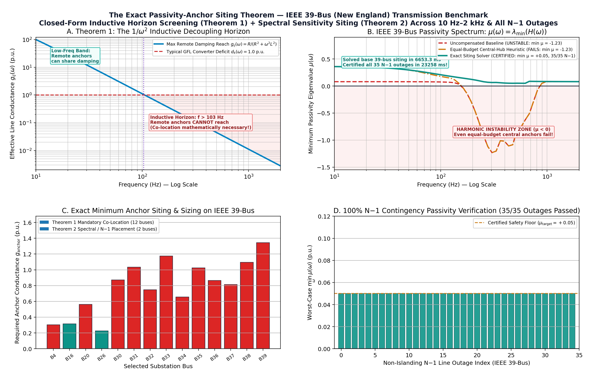

# The Inductive Decoupling Horizon

**Exact $dq$-Domain Passivity-Anchor Siting and Fast $N-1$ Certification for Converter-Dominated Transmission Grids**

[](inductive_decoupling_horizon_preprint.pdf)
[](ieee39_passivity_siting.py)
[](LICENSE)
[](#citation)

**Author:** Ruben Aronica — *Independent Researcher, Gheorgheni, Romania*  
**Manuscript:** [Read the Full Technical Preprint (PDF)](inductive_decoupling_horizon_preprint.pdf)

---

## Overview

As transmission grids transition toward $100\%$ inverter-based resources (IBRs), negative-damping pockets in proprietary grid-following (GFL) converters trigger wideband harmonic instabilities ($100\text{ Hz}$ to $2\text{ kHz}$). Standard utility practice places grid-forming (GFM) batteries or STATCOMs at high-degree central transmission hubs and validates designs through slow electromagnetic transient (EMT) trial-and-error.

This repository accompanies the preprint proving why central-hub siting fails above an explicit physical barrier—the **Inductive Decoupling Horizon**. Because high-voltage branch conductance decays quadratically with frequency as $g_{ij}(\omega) = R_{ij} / (R_{ij}^2 + \omega^2 L_{ij}^2) = O(1/\omega^2)$, transmission lines act as inductive walls above roughly $100\text{ Hz}$, isolating remote dampers from resonant buses.

Using $2\times 2$ rotating $dq$-domain block Schur complements (**Theorem 1**) and Cholesky-screened spectral sensitivity updates with $O(1)$ rank-1 branch downdates (**Theorem 2**), our open-source solver replaces weeks of EMT tuning with sub-second, vendor-agnostic $N-1$ passivity certification.

---

## Key Results

| Benchmark ($10\text{ Hz}$ to $2\text{ kHz}$, $T_d = 25\text{ }\mu\text{s}$) | Equal-Budget Central-Hub Heuristic | **Proposed Solver (Algorithm 1)** | Runtime |
|---|---|---|---|
| **IEEE 39-Bus ($78\times 78$ $dq$ vs. Global SDP)** | Fails ($\mu_{\min} = -1.232$) | **$+0.35\%$ gap to exact global SDP** (Thm. 1 captures $92.3\%$ in $<5\text{ ms}$) | $3.59\text{ s}$ |
| **IEEE 39-Bus Full $N-1$ Certification** | $0 / 35$ passed | **$35 / 35$ certified** ($\mu_{\min} = +0.0501$, budget $11.035\text{ p.u.}$) | **$0.97\text{--}1.60\text{ s}$** |
| **IEEE 39-Bus $40\text{ kHz}$ Dommel EMT** | Explodes ($1.524\text{ p.u.}$ at $325\text{ Hz}$) | **$+73.6\text{ dB}$ suppression**, $20.8\text{ ms}$ post-$N-1$ settling | $\Delta t = 25\text{ }\mu\text{s}$ |
| **118-Bus Scale (186 Branches, 35 GFL)** | $0 / 186$ passed ($\mu_{\min} = -1.200$) | **$186 / 186$ certified** (Thm. 1 capture: $91.3\%$ in $0.40\text{ ms}$) | $31.98\text{ s}$ |
| **200-Bus Scale (320 Branches, 50 GFL)** | $0 / 320$ passed ($\mu_{\min} = -1.196$) | **$320 / 320$ certified** (Thm. 1 capture: $94.4\%$ in $0.40\text{ ms}$) | $84.17\text{ s}$ |


*IEEE 39-Bus verification across $10\text{ Hz}$ to $2\text{ kHz}$: the $103\text{ Hz}$ Inductive Decoupling Horizon, failure of equal-budget central-hub placement ($\mu_{\min} = -1.23$), exact per-bus sizing, and $35/35$ $N-1$ contingency certification. Additional $40\text{ kHz}$ Dommel EMT and 118-/200-bus scalability figures are available in [`figures/`](figures/).*

---

## Quick Start

Requires only Python `3.9+`, `numpy`, and `scipy` (no commercial EMT or SDP software needed):

```bash
git clone https://github.com/Rubenskiada/Inductive-decoupling-horizon.git
cd Inductive-decoupling-horizon
pip install numpy scipy
python ieee39_passivity_siting.py
```

**Expected deterministic output:**
```text
N-1 contingencies passed : 35/35 (mu >= +0.05)
Mandatory buses (Thm 1)  : [4, 20, 30, 31, 32, 33, 34, 35, 36, 37, 38, 39]
All placed buses (14)    : [4, 16, 20, 26, 30, 31, 32, 33, 34, 35, 36, 37, 38, 39]
Total anchor conductance : 11.035 p.u.
```

---

## Repository Structure

```text
Inductive-decoupling-horizon/
├── inductive_decoupling_horizon_preprint.pdf   # Full technical preprint manuscript
├── main.tex                                    # IEEEtran LaTeX source
├── ieee39_passivity_siting.py                  # Sub-second N-1 passivity-anchor siting solver
├── LICENSE                                     # MIT License
├── README.md                                   # Project overview
└── figures/
    ├── ieee39_passivity_siting_theorem.png     # Fig. 1: IEEE 39-Bus horizon & N-1 results
    ├── ieee39_emt_303hz_verification.png       # Fig. 2: 40 kHz 39-bus Dommel EMT validation
    └── ieee118_scalability_benchmark.png       # Fig. 3: 118-bus & 200-bus scalability
```

---

## Citation

If you use this solver or theoretical framework in your research, please cite:

```bibtex
@misc{aronica2026inductive,
  author       = {Aronica, Ruben},
  title        = {The Inductive Decoupling Horizon: Exact dq-Domain Passivity-Anchor Siting and Fast N-1 Certification for Converter-Dominated Transmission Grids},
  year         = {2026},
  month        = nov,
  howpublished = {Technical Preprint, GitHub / Zenodo},
  url          = {https://github.com/Rubenskiada/Inductive-decoupling-horizon}
}
```
*(Update with the minted Zenodo DOI after publishing release `v1.0.0`.)*

## License

Code is released under the [MIT License](LICENSE). The preprint manuscript and figures are made available for academic and research use under CC BY 4.0.